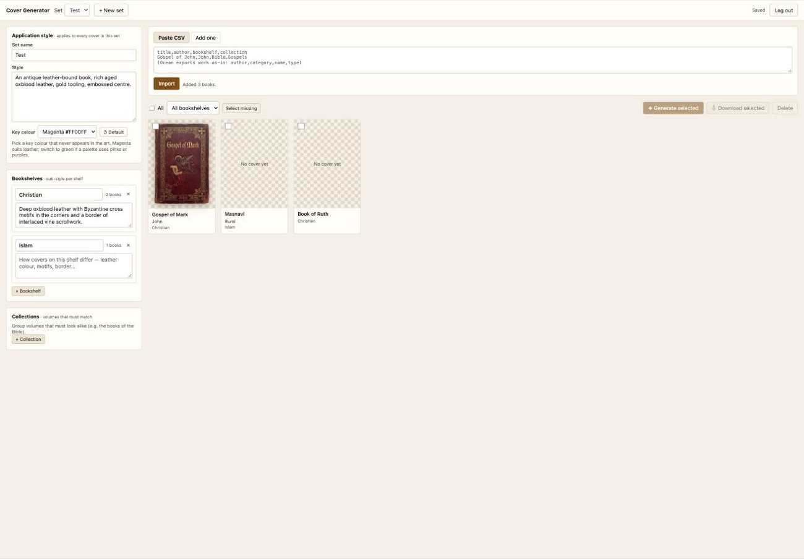
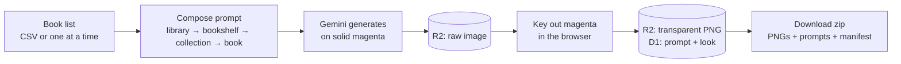
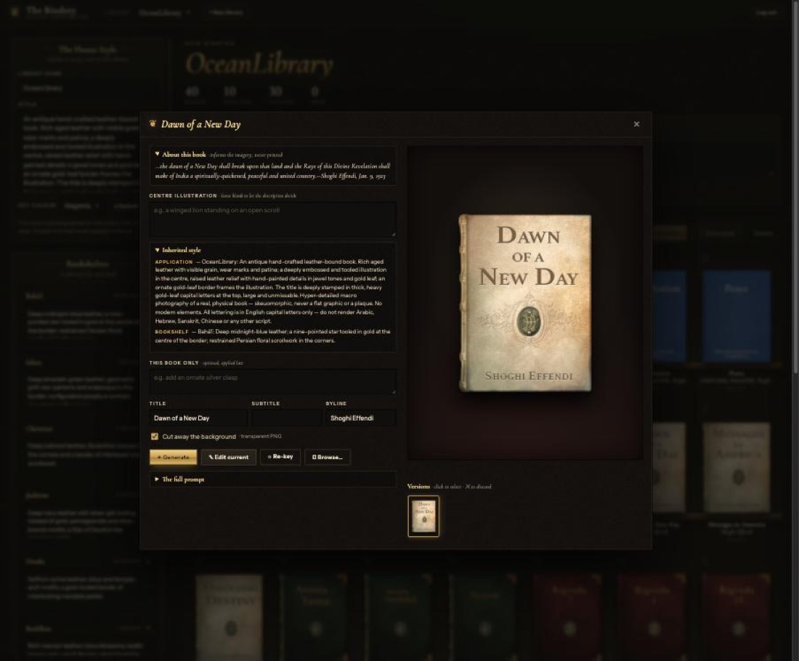

# Bindery Cover Generator

Generate consistent, photorealistic book covers for a whole library, with backgrounds that come out
cleanly transparent.

Paste a list of books, describe the look once at three levels (the whole library, each bookshelf,
each collection), and generate. Every cover comes back as a transparent PNG you can drop onto any page,
alongside the exact prompt that made it, so any single cover can be regenerated later.

**Live demo: [bindery.lnker.com](https://bindery.lnker.com)**
*(anyone can browse; adding, editing and generating need the admin password, because every generation spends Gemini credit; ask Chad for it)*



> Proof of concept. It runs today and produces usable covers; the roadmap below lists what a
> production version would add.

---

## How a cover gets made



### 1. Describe the look in layers

A library's covers should feel like one collection and still tell each book apart. Style is stacked
from most general to most specific:

| Layer | Applies to | Example |
|---|---|---|
| **Application** | every cover in the set | antique hand-tooled leather, gold-leaf border, embossed centre |
| **Bookshelf** | one shelf, such as a tradition or genre | deep oxblood leather, Byzantine crosses in the corners |
| **Collection** | volumes that must match, such as the four Gospels | identical border; a roundel carries each evangelist's symbol |
| **Book** | one cover (optional) | add a silver clasp |

A collection also tells the model that its volumes must match one another in leather, border,
typography and layout, and differ only in title and centre illustration. That's how a multi-volume
set stays a set.

### 2. Book metadata guides the imagery

Each book's description and bookshelf go into the prompt as **context**: they guide the choice of
imagery and symbolism, and the prompt forbids printing them on the cover. If no centre illustration is
specified, the model chooses one that evokes the book's subject. Type one in the Image Manager to override that.

### 3. Generate on a key colour

The prompt asks for the book photographed from above on **solid magenta** (`#FF00FF`), with a
visible margin, no shadow and no vignette. Those requirements are stated at the start of the prompt
and repeated as a numbered list at the end, because the model drifts without the repetition.

<p align="center"></p>

### 4. Key out the background

Background removal is solved **at generation time**, not afterwards. Generic background removers
fail on leather: the worn edges fade gradually into the background, so there's no clean line to cut.
A colour that never appears in the art can be removed precisely. The keyer runs in four passes:

1. **Sample** the real background from the four corners. Don't assume pure `#FF00FF`, because the
   model adds vignetting.
2. **Flood-fill from every border pixel**, not just the corners, so magenta trapped in notches
   along the edge is reached too.
3. **Remove shadow**, repeating until nothing changes. A shadow on magenta keeps magenta's hue, so a
   plain colour-distance test misses it.
4. **Despill** the pink fringe, but keep those pixels **fully opaque**. Semi-transparent edges look
   chewed.

Then trim to the book and add a 12px transparent pad, so worn corners never touch the image edge.

<p align="center"></p>

*The same cover after keying, over a checkerboard and over black. The torn edges and spine are kept,
there's no pink fringe, and the lettering is solid.* On a real 896×1200 generation the keyer takes
about **0.1 seconds**.

Keying runs in your browser on the raw image saved in R2. Re-keying is free: it never pays for a new
generation. If a cover's proportions look wrong (cropped or mis-framed art), it's flagged so you can
regenerate it rather than fiddle with the cutout.

### 5. Refine one cover

Click any cover to open the **Image Manager** (modelled on NovelArabic's image editor):




- **Content prompt**: what the centre illustration shows ("a winged lion on an open scroll").
- **Inherited style**: the application, bookshelf and collection layers that apply, shown for reference.
- **Style override**: anything specific to this one book.
- **✦ Generate**: a new cover from the prompt.
- **✎ Edit**: change the *current* cover ("add an ornate silver clasp") instead of starting over.
- **⟳ Re-key**: run the background removal again on the saved raw image.
- **Upload…**: use an image from your computer.
- **Backdrop**: the preview sweeps through dark, colour and light (or holds dark, light or a checkerboard), so a
  bad cut-out shows at once. The whole app also has a light/dark switch (◐): covers must read on both.
- **History**: every render is kept, labelled with the look that made it. Click one to make it the current
  cover. Nothing is ever deleted.

### 6. Iterate on a look

A **look** is a snapshot of every style layer (library, each shelf, each collection). It's saved
automatically the first time you generate with new styles, and every cover records the look that made it.

1. Star (★) two or three representative books on each shelf. These are the **samples**.
2. Edit the library style (from the top bar) or a shelf's style (from its header).
3. **✦ Try look** generates every sample with the current styles; **✦ Samples** on a shelf header does one
   shelf.
4. **Looks** shows the results as a grid: one row per look, one column per book. Name the look, add notes
   on what worked, or **Restore** an earlier look's styles.

### 7. Download

Select covers and click **⇩ Download** in the selection bar to get a zip containing:

```
gospel-of-mark-john.png    transparent cover
gospel-of-mark-john.txt    the exact prompt that made it
manifest.csv               file, title, author, bookshelf, collection, look
```

---

## Using the demo

The demo holds two libraries, each seeded with its **published** books (those live on the site today).
Every book that had a cover on the live site carries that cover as **version 1**, so you can compare the
current cover with a new one side by side.

| Library | Books | Bookshelves |
|---|---:|---|
| **OceanLibrary** | 457 | 10 traditions (Bahá'í, Islam, Christian, Hindu, Buddhist, …), each with its own leather and motifs |
| **WholeReader** | 586 | 9 genres (Short Stories, Novels, Children, Drama, …) in Victorian cloth bindings |

1. Open the [demo](https://bindery.lnker.com). Browsing is open; **Log in to edit** asks for the passcode.
2. Choose a library from the top bar. Each library has its own address (`/oceanlibrary`), and so does each
   shelf (`/oceanlibrary/islam`) when you pick it from **All shelves** to focus on one.
3. Add books with **+ Books**:
   - **Paste CSV**: headers in any order or case. `title, author, bookshelf, collection` works, and so do
     common alternatives (`name`, `category`, `series`…). The Ocean library export
     (`author,category,name,type`) imports as-is. A headerless `title,author` paste works too.
     "Unknown" authors are dropped from the cover.
   - **Add one**: title, author, bookshelf, collection.
4. Write the **Library style**, then open each shelf's **Shelf style** from its sticky header. Collections
   are edited in the shelf they belong to.
5. Star sample books and **✦ Try look** (see *Iterate on a look*). Once the look is right, select many and
   **✦ Generate** from the selection bar (two at a time, ~20 seconds each).
6. Open any cover to refine it, then select and **⇩ Download**.

---

## Architecture

| Part | What it does |
|---|---|
| [`core/`](core/) | **All the cover logic, with zero dependencies**: prompt layering, the keyer, CSV import, looks, the Gemini call. It runs unchanged in the browser, the Worker and Node. |
| [`src/worker.js`](src/worker.js) | Cloudflare Worker: public reads, passcode for writes, a Gemini proxy so the API key never reaches the browser, image serving from R2. Also serves the page at clean paths (`/<library>/<shelf>`). |
| [`src/store.js`](src/store.js) | The D1 data layer: libraries, shelves, collections, books, versions, looks. Versions and looks are append-only. |
| [`migrations/`](migrations/) | D1 schema. `npm run deploy` applies new migrations before deploying. |
| [`public/`](public/) | The page. Keying runs here, with the same `core/` code. |
| D1 database `bindery` | All data and every prompt, including the look each cover was made under. |
| R2 bucket `cover-generator` | Images only: raw generations and keyed PNG covers, under `sets/<library>/`. Nothing is deleted. |

To reuse the generator without the app, copy [`core/`](core/). [`core/README.md`](core/README.md)
has a Node example.

---

## Development

```sh
npm install
npm test                          # 51 tests: keyer, prompts, CSV, Gemini client, looks, D1 store
cp .dev.vars.example .dev.vars    # add GEMINI_API_KEY and ADMIN_PASSWORD (the one password, dev and prod)
npm run dev                       # http://localhost:8788 (pinned) on the LIVE D1 + R2
```

**Local dev uses live data.** The D1 and R2 bindings are marked `"remote": true` in `wrangler.jsonc`, so
`npm run dev` reads and writes the production database and bucket. What you change locally is what the site
shows. The store tests run the real migrations on Node's built-in SQLite (`test/d1-shim.js`), so they
don't touch live data.

`npm run dev` and `npm run deploy` first copy `core/` into `public/core/`, so the browser runs the same
files as the Worker and the tests. Always edit `core/`, never `public/core/`, and always deploy with
`npm run deploy` (a bare `wrangler deploy` would ship whatever stale copy is there).

## Deployment

The demo runs on Chad's personal Cloudflare account (`account_id` in [`wrangler.jsonc`](wrangler.jsonc)), served at
**bindery.lnker.com** (custom domain; the `workers.dev` address is off).

**One-time setup** (already done for the demo):

```sh
npx wrangler r2 bucket create cover-generator
npx wrangler d1 create bindery
npm run secrets                   # copies ADMIN_PASSWORD + GEMINI_API_KEY from .dev.vars to production
```

The password lives only in `.dev.vars`. Cloudflare secrets can't be read back, so after changing it there,
run `npm run secrets` again.

`npm run deploy` copies `core/` into `public/core/`, applies any new D1 migrations, then deploys.

**Deploy on every push** with Cloudflare Workers Builds (a one-time dashboard step, because it authorizes
Cloudflare's GitHub app):

1. Cloudflare dashboard → **Workers & Pages** → `cover-generator` (the Worker keeps its original name) → **Settings** → **Builds** → **Connect**.
2. Choose GitHub repo `chadananda/Bindery-Cover-Generator`, branch `main`.
3. Leave the build command empty. Set the deploy command to `npm run deploy`.

From then on, every commit to `main` deploys the demo. The secrets, the R2 bucket and the D1 database
carry over, because they belong to the Worker, not the build.

Optional: set a `GEMINI_MODEL` variable to override the default `gemini-3-pro-image-preview`.

---

## Roadmap

- **Accounts instead of a shared passcode** (e.g. Cloudflare Access), with per-user spend limits.
- **Batch jobs that run on the server**, so a 600-cover run doesn't need the browser tab open.
- **Automatic re-roll** when a cover fails the proportion check.
- **More style profiles**: WholeReader (Victorian cloth bindings, no tradition column) is next.

## Credits

The keying method is the *Book Cover Generation* recipe, proven first on CTAI.info. The Image
Manager follows the one in NovelArabic.

## License

MIT
